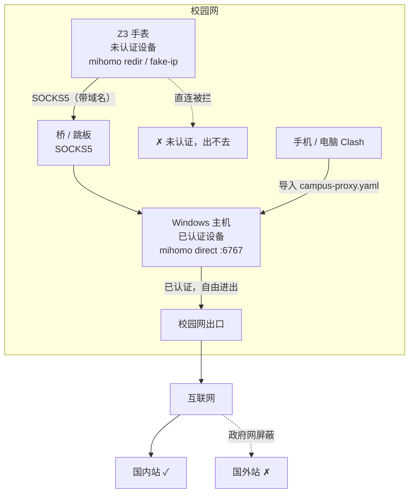

**观前提醒：本文章所提到的方法是在已授权的情况下进行，请勿因为尝试绕开校园网认证而尝试此方法🤪，也不要尝试使用班级里的一体机来充当桥接节点🤪，本文章仅供学习分享**

学校那边批了一台“不停机电脑”的权限，也允许在校内局域网架桥。但限制不少：

- 学校网络是政府机关网，强制屏蔽所有国外网站；
- 主机是 Windows；
- 手表是小天才 Z3，Android 7.1.1，msm8909w，armv7，Magisk root；
- 最要命的一条：**别动 IP**。不要加网卡别名、不要给手表配静态 IP、不要搞 NAT 那套，客户端直接连主机现有的局域网 IP。

一开始我做过一版 NAT 网关：给主机加 `192.168.137.1/24` 别名，手表改成静态 IP + 网关 + DNS。技术上能用，但不符合“别动 IP”，而且多一层网段就多一层排错。于是全部推倒，改成“主机开一个代理端口，手表用 Clash 连过去”。

> 这台主机是学校资产，桥接也是走批准流程的🤪；下面的改动只在这台主机和我的手表上，认证和防火墙按最小范围来。

## 为什么不是 HTTP 代理

Android 的 WiFi 设置里有“代理”，但那是系统 HTTP 代理，只有走 `HttpURLConnection` / OkHttp 的应用会遵守。QQ 手表版的 `com.tencent.qqlite:MSF` 是自己实现的 socket，根本不看系统代理——只开 HTTP 代理的话，浏览器可能通了，QQ 还是“没联网”。

能覆盖所有应用的只有两条路：

1. 三层网关：手表默认网关指向主机，主机做 NAT；
2. 手表上跑透明代理：iptables 把 TCP 重定向到本地 Clash，Clash 再把流量转给主机。

第 1 条要改 IP，放弃。第 2 条就是现在的方案：



主机侧是一个 mihomo `direct` 实例：mixed-port 6767、`allow-lan`、不开认证、防火墙只放行私网来源。它不做二次转发，就是拿主机自己的网络出去。手机/笔记本那边，部署时会生成一个完整的 `campus-proxy.yaml`，直接导入普通 Clash 就能用。

## 主机侧

政府网把 GitHub 也屏蔽了，所以 mihomo 核心必须提前放在 U 盘里，脚本不能联网下载。主机上也没时间先复制一堆文件，所以需要U 盘插上，直接运行，部署到 C 盘。

最后的形态：

```text
U 盘\host_proxy\
├── deploy-host-proxy.bat     # 单文件，内嵌 PowerShell
├── bin\mihomo.exe            # 61MB，Windows amd64
└── （部署后生成）campus-proxy.yaml
```

bat 的逻辑：

1. `fltmc` 判断是否管理员，不是就 `Start-Process -Verb RunAs` 弹 UAC；
2. 把自己所在目录（U 盘）通过 `-BaseDir` 传给内嵌脚本；
3. 内嵌 PowerShell 临时释放到 `%TEMP%` 执行，跑完删除；
4. 从 `U盘\host_proxy\bin\mihomo.exe` 读核心，复制到 `C:\CampusProxy`；
5. 写配置、防火墙、计划任务，当前台打印一次 IP/端口，然后 `pause`；
6. 把 `campus-proxy.yaml` 写回 U 盘目录，拔盘拿走。

## 手表侧：mihomo 接管所有 TCP

手表是 Z3，Android 7.1.1，armv7。核心用的是 mihomo 的 **linux-armv7 静态编译**版本，不是 android-armv7——后者是动态链接、按 API 34 构建的，在 7.1 上有 linker 风险；静态版反而更稳。先在手表上验证：

```bash
adb shell "su -c '/data/local/tmp/clash/mihomo -v'"
# Mihomo Meta v1.19.33 linux arm with go1.26.10
```

配置的关键是 `redir-port` + fake-ip + `mode: global`：

```yaml
mode: global
redir-port: 7892
dns:
  enable: true
  listen: 0.0.0.0:1053
  enhanced-mode: fake-ip
  fake-ip-range: 198.18.0.1/16
proxies:
  - name: PC
    type: socks5
    server: "<主机IP>"
    port: 6767
proxy-groups:
  - name: GLOBAL
    type: select
    proxies: [PC]
rules:
  - MATCH,PC
```

> 之前那篇 Z3 文章里的 `persist.sys.selfstart.open=1` 得保持；不然网络通了，QQ 的 `:MSF` 还是会被厂商的 ovum 框架拦在进程外面。

### 最大的坑：`mode: global` 默认选 DIRECT

我一开始以为 `mode: global` 就是“所有流量走唯一那个 proxy”。实测不是：起一个只有 `PC` 的配置，`GET /proxies/GLOBAL` 返回的是：

```json
{"all":["DIRECT","REJECT","PC"],"now":"DIRECT"}
```

global 模式用的是内置的 `GLOBAL` 选择器，默认选中 `DIRECT`，流量直接漏过去。解决办法是在配置里显式定义一个只包含 `PC` 的 `GLOBAL` 选择器：

```yaml
proxy-groups:
  - name: GLOBAL
    type: select
    proxies: [PC]
```

这样 `GLOBAL` 的 `all` 只有 `PC`，`now` 也是 `PC`，没有 DIRECT/REJECT 可选。实测请求确实带着域名进了 SOCKS5。

iptables 这边：

```bash
# 本机、到主机、公共 DNS 不劫持
-A CLASH_WATCH -o lo -j RETURN
-A CLASH_WATCH -d 127.0.0.0/8 -j RETURN
-A CLASH_WATCH -d "$LAN_IP" -j RETURN
-A CLASH_WATCH -d 223.5.5.5 -p udp --dport 53 -j RETURN
-A CLASH_WATCH -d 119.29.29.29 -p udp --dport 53 -j RETURN
# DNS 进 fake-ip，TCP 进 redir
-A CLASH_WATCH -p udp --dport 53 -j REDIRECT --to-ports 1053
-A CLASH_WATCH -p tcp -j REDIRECT --to-ports 7892
```

QUIC（UDP 443）在 filter 表里 REJECT，逼应用回退 TCP；IPv6 整条链 REJECT，防止绕过代理。看门狗是 `run` 循环，mihomo 退出 2 秒后拉起，5 秒内反复挂就退避 10 秒；mihomo 和看门狗都设 `oom_score_adj=-1000`。

### 真机上的意外：toybox 没有 awk

脚本里用 `ps | awk '{print $2}'` 兜底杀进程，到了 Z3 上直接报：

```text
start.sh[69]: awk: not found
```

这台 Android 7.1 的 toybox 没带 awk。好在主路径是 pid 文件，没受影响；但兜底逻辑等于没有。改成纯 shell：

```sh
ps 2>/dev/null | grep 'mihomo' | grep -v grep | while read -r _u p _rest; do
    kill -9 "$p" 2>/dev/null
done
```

顺手把 `ndc resolver flushdefaultif` 也吞掉了——这台 ROM 上它会报 `500 0 Resolver missing arguments`，反正 fake-ip 对新查询照样生效，缓存刷新不是必须的。

## 预验证

脚本写完后人在家里，主机在学校，IP 根本不可达。但“mihomo 能不能接管所有流量”这件事可以先测。

思路：在电脑上起一个本地 SOCKS5，`adb reverse` 映射到手表，让手表的 mihomo 上游指向 `127.0.0.1:16767`。除了上游地址，代码路径和生产完全一样。

```bash
# 电脑上起 SOCKS5，监听 127.0.0.1:16767
# 手表上：
adb reverse tcp:16767 tcp:16767
adb shell "su -c 'sh /data/local/tmp/clash/start.sh 127.0.0.1 16767'"
```

然后从手表 shell（uid 2000，普通应用 uid）发 HTTP：

```bash
adb shell "(printf 'GET / HTTP/1.0\r\nHost: www.baidu.com\r\n\r\n'; sleep 8) | toybox nc -w 14 www.baidu.com 80"
```

返回 `HTTP/1.0 200 OK`。mihomo 日志：

```text
[TCP] 192.168.10.33:36322 --> www.baidu.com:80 using GLOBAL
```

再启动 QQ，日志里出现：

```text
[TCP] 192.168.10.33:52441 --> ts.qq.com:33445 using GLOBAL
[TCP] 192.168.10.33:52443 --> ts.qq.com:33445 using GLOBAL
[TCP] 192.168.10.33:45004 --> 36.155.187.225:443 using GLOBAL
[TCP] 192.168.10.33:57809 --> android.rqd.qq.com:80 using GLOBAL
```

电脑侧的 SOCKS5 日志里，`CONNECT` 的目的地是**域名**，不是 198.18.x.x——说明 fake-ip 把域名带到了上游，DNS 解析发生在主机侧。这一步验证了三件事：应用流量被接管、DNS 没漏、上游拿到了域名。

> `toybox nc` 第一次测出来是空响应：它发完请求会立刻半关 stdin，代理还没把响应送回来连接就结束了。把 stdin 保持打开（`(printf ...; sleep 8) | nc ...`）就正常。这是测试客户端的脾气，不是 mihomo 的问题。

测完 `stop.sh` 一跑，iptables 链清空，手表恢复直连，`nc` 又能直接 200。

## 回学校

到学校，手表连上校园 WiFi，把运行过脚本的主机的 IP 填进去：

```bash
adb shell "su -c 'sh /data/local/tmp/clash/start.sh <主机IP> 6767'"
```

这次上游从 `127.0.0.1:16767` 换成了 `主机IP:6767`，其他一模一样。QQ 正常，网页正常，收工。

主机 IP 是 DHCP 的话会变，`deploy-host-proxy.bat -Status` 会显示当前网卡 IP；手表那边重跑一次 start.sh 带新 IP 就行，不用改文件。

## 几个结论

1. **Clash 的 `mode: global` 不等于“走你的节点”**。内置 GLOBAL 默认 DIRECT，必须自己定义一个只含目标节点的 GLOBAL 选择器，否则流量静默漏掉。
2. **Android 的“系统代理”对 QQ 无效**。要覆盖所有应用，只能在手表侧做透明代理（redir/TUN），或者做三层网关；HTTP 代理只能骗到守规矩的应用。
3. **U 盘直接部署的关键是 `-BaseDir`**。单 bat 内嵌 PowerShell 会把脚本释放到 `%TEMP%`，`$PSScriptRoot` 不再是 U 盘；不传目录，核心文件永远找不到。
4. **Windows 静默自启用 wscript + VBS 最稳**：`Run(..., 0, True)` 隐藏窗口并保持任务存活，`run.cmd` 里做崩溃重拉；`timeout` 在隐藏窗口里会因 stdin 重定向失败，用 `ping` 当 sleep。
5. **别假设 Android 的 toybox 什么都有**。这台 7.1 没有 awk，`ps | awk` 的兜底逻辑直接失效；pid 文件 + `ps | while read` 更可靠。
6. **`adb reverse` 是很好的代理测试台**。主机不可达时，本地起一个 SOCKS5，把手表的 mihomo 上游指过去，就能验证 redir、fake-ip、域名转发和全局模式，不用等回学校。
7. **政府机关网只保证国内站**。主机 direct 出去的就是学校出口，国外站打不开不是代理坏了；要出去得在主机上链一个能用的上游。测试也尽量用 `www.baidu.com`，别拿 `example.com` 当“代理正常”的标准。
8. **无认证是取舍**。默认不开认证、防火墙只放行私网，同网段知道 IP:端口的人都能用；要收紧就部署时加 `-Password`，或者把防火墙再缩小到具体设备。

## 回滚

```powershell
# 主机
deploy-host-proxy.bat -Uninstall

# 手表
adb shell "su -c 'sh /data/local/tmp/clash/stop.sh'"
adb shell "su -c 'rm -rf /data/local/tmp/clash'"
```

主机卸载会删计划任务、防火墙规则和 `C:\CampusProxy`；手表 stop 会撤 iptables、杀看门狗和 mihomo、清 DNS 缓存。
