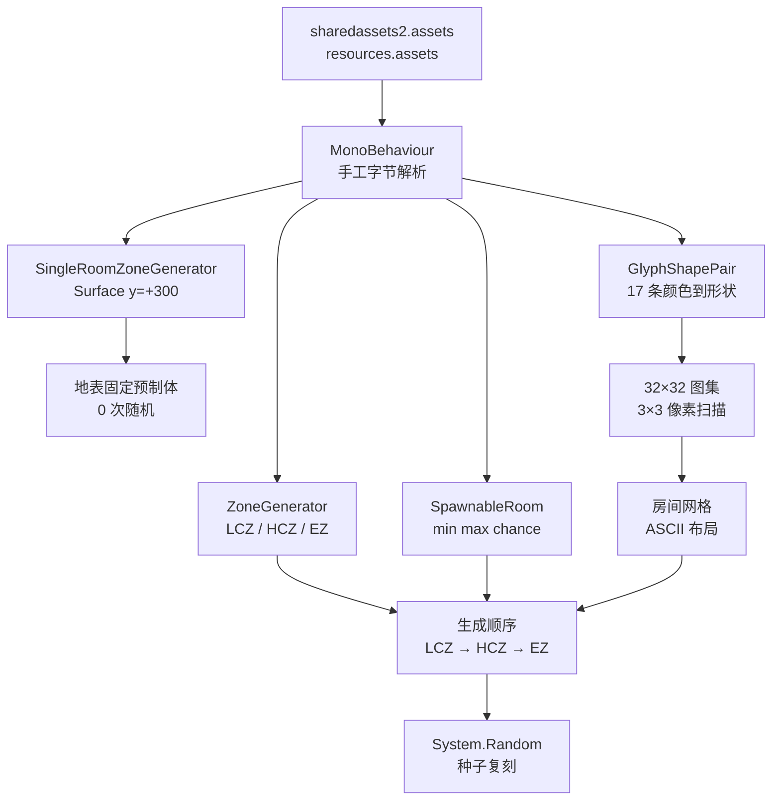

SCP:SL 15.0 的 metadata 被 Northwood 改得面目全非：版本号是假的、header 是自定义的、表条目是压缩的，三个主流 IL2CPP 工具全部读不出来。更麻烦的是，地图生成和定位也跟着重写了——14.2.9 时代 `SurfaceMap` 里两个硬编码的世界坐标常量，在 15.0 里直接消失。

这篇记录两件事：一是怎么在没有符号、没有 TypeTree、版本号还被故意写错的 IL2CPP 包里把 12 万个方法挖出来；二是怎么在不装运行时插件的前提下，把地图生成机制从 Unity 资源里离线还原，做到给定种子就能算 LCZ/HCZ/EZ 的房间布局（地表是固定预制体）。

> 观前提醒：下面的内容是为了自己设备上的互操作性研究（读取游戏数据、理解地图生成），不涉及绕过反作弊、不分发游戏资源。客户端是自己买的，所有数据来自本机文件。文章里会出现房间名、图集和生成规则，包含地图剧透。

## 先说结论

- 15.0 的 metadata 有四层防线：假版本号、删 sanity、完全自定义的 header、压缩的表条目；三个主流工具全部失败。
- 从 `il2cpp_init` 的运行时锚点出发，可以稳定恢复出 **122,167 个方法、19,727 个类型、110 个程序集**，而且方法到类型的归属 100% 闭环。
- beta-2 和 beta-1 的布局完全一致，只平移了偏移；脚本换 7 个常量就能复跑。
- 地图生成完全可以离线：图集、颜色映射、房间权重、连接器配置都在 Unity 序列化资源里，不需要运行时插件，也不需要运行时反射。
- 17 张 32×32 图集（全部属于 LCZ/HCZ/EZ）、17 条颜色到形状的映射、LCZ 20 / HCZ 33 / EZ 19 个房间、13 个连接器，全部拿到。地表 0 张图集，是固定预制体。
- 生成算法的随机数消耗序列已经用机器码逐行核对，配合 .NET `System.Random` 的复刻，给定种子可以离线复现 LCZ/HCZ/EZ 的房间布局；地表是固定布局，不受种子影响。
- 15.0 删掉了 `SurfaceMap` 的硬编码常量，改用 `RoomUtils` 网格坐标；beta-2 又新增了 `WorldspaceBounds`。任何依赖旧常量的外部工具都会直接失效。

## 一、15.0 的四层防线

15.0-beta-2 的客户端版本串是 `15-0-private-beta-2-4dadfe82`，buildid 26706489，Unity **6000.4.11f1**，IL2CPP。`global-metadata.dat` 的头部版本字段写的是 **23**——这是 Unity 6 根本不会用的版本号（实际布局是 v31.1 一路改出来的）。这一步就足够让所有按版本分派的解析器走错分支。

| # | 防线 | 细节 |
|---|------|------|
| 1 | 假版本号 | header version 写 23，实际是 v31.1 的自定义布局 |
| 2 | 删 sanity | 标准 IL2CPP 的 `0xFAB11BAF` 在 GameAssembly.dll 里零代码引用，文件头“看似标准”是诱饵 |
| 3 | 自定义 header | header 扩展到至少 380 字节（标准 v31 是 248），槽位排列只有 NW 运行时知道；有些槽存的是条目数，不是标准的 (offset, size) 对 |
| 4 | 压缩表条目 | 索引字段缩成 u16（`parameter.typeIndex`、`method.declaringType`），条目大小不等于任何标准版本 |

另外，GameAssembly.dll 里有约 76MB 的非标准 `il2cpp` 自定义节，`global-metadata.dat` 里的字符串在代码里零引用——典型的 SL-AC 反作弊处理痕迹。

三个主流工具实测全灭：

- **Il2CppDumper v6.7.46**：duplicate key 崩溃；
- **Cpp2IL pre-release.21**：能识别 v31.1，但读表越界；
- **Il2CppInspectorRedux 2026.2**：integrity 校验失败。

这不是“工具不够新”，而是 NW 把结构本身改了。要继续，只能自己找锚点。

## 二、从 `il2cpp_init` 挖到 header

### 2.1 运行时锚点

先找导出表里的 `il2cpp_init`（RVA `0x55A3F0`），顺着调用链：

```text
il2cpp_init (0x55A3F0)
  → Runtime::Init (0x4D0D80)
  → LoadMetadataFile (0x4D0820 → FileMapping::Create 0x51FE20)
  → MetadataCache::Initialize (0x4DC5A4)
```

`Initialize` 的第一条指令就 `call LoadMetadataFile`，返回值（映射基址）被写进全局：

```text
s_GlobalMetadata = RVA 0x6122EE0
header 指针 g_EF0 = RVA 0x6122EF0   ← 所有字段读取都经过它
宽度决策缓存 ×4   = RVA 0x6122ED0-DC
```

拿到 `g_EF0` 之后，全二进制扫描 `mov r64,[rip→g_EF0]` 后紧跟 `[reg+N]` 的访问，能挖出 34 个以上的槽位。

### 2.2 槽位是三元组

关键发现是：很多槽不是一对 (offset, size)，而是 **(offset, size, count)** 三元组。比如：

```text
[0x38]=3442040  [0x3c]=465360  [0x40]=23268   → properties
[0x44]=3907400  [0x48]=3664800 [0x4c]=122160  → methods
```

有了 count 就能反推条目大小：`3664800 / 122160 = 30B`，正好是 methods 的条目长度。再用 `GetIndexFromPointer` 的边界行为验证，30B 这个值就钉死了。

### 2.3 区域链

把 header 值流里所有 `(offset, size)` 拿出来，按“首尾相接 + 4 字节对齐”排序，29 个区域端点能一路闭合到文件尾：

```text
15897620 + 12468 = 15910088 = global-metadata.dat 的文件大小
```

这一步很重要：它证明我们不是碰巧读对了几张表，而是把整个文件的区域划分都恢复出来了。


### 2.4 破译出的表布局

beta-1 的实测区域：

| 区域 | offset | size | 内容 |
|------|--------|------|------|
| stringLiteral | 380 | 99,496 | 12,437 条 (length, dataIndex) |
| stringLiteralData | 99,876 | 713,172 | 用户字符串 |
| **string** | **813,048** | **2,616,384** | 标识符，`\0` 分隔 |
| properties | 3,442,040 | 465,360 | 23,268 条 × 20B |
| **methods** | **3,907,400** | **3,664,800** | **122,160 条 × 30B** |
| parameters | 9,476,948 | ~1,275,990 | 127,599 条 × 10B |
| **typeDefinitions** | **12,740,332** | **~1,498,900** | **19,721 条 × 76B**，按程序集分块 |
| images | 14,239,208 | 3,960 | 110 × 36B |
| assemblies | 14,243,168 | 7,480 | 110 × 68B |
| vtableMethods | 15,897,620 | 12,468 | u32 方法索引 |

NW 压缩后的条目布局（和所有标准版本都不一样）：

```text
Il2CppMethodDefinition — 30 B（122,160 条）
  +0  nameIndex            i32   → string 区
  +4  declaringTypeIndex   u16   → typedefs[值-1]   ★ 1-based
  +6  returnTypeIndex      u16
  +8  returnParameterToken u32   （多恒 0）
  +12 parameterStart       u16
  +16 (u16)
  +18 token                u32   0x06xxxxxx，按 1 递增
  +22 flags/iflags/slot    u16 × 3
  +26 parameterCount?      u16（max 30）
  +28 (u16)

Il2CppParameterDefinition — 10 B（127,599 条）
  +0 nameIndex   i32
  +4 token       i32   0x0800xxxx，按 1 递增
  +8 typeIndex   u16

Il2CppPropertyDefinition — 20 B（23,268 条）
  +0 nameIndex i32 / +4 get i32 / +8 set i32 / +12 attrs / +16 token 0x17xxxxxx

Il2CppTypeDefinition — 76 B（19,721 条，按程序集分块连续存放）
  +0  token             u32   0x02xxxxxx（row 每程序集从 1 重启）
  +4  nameIndex         i32
  +8  namespaceIndex    i32
  +12..47 索引组（多为 -1 填充，含 u16 压缩索引）
  +48 fieldStart        i32（0,4,8,12… 单调）
  +28 methodStart       i32（0,6,7,9… 单调）
  +72 flags/bitfield    u32（常见 0x0C00）
```

区块之间经常塞 `0x61`（字符 `a`）填充和 4B 对齐，明显是反逆向噪声。

### 2.5 交叉验证

提取出 122,160 个方法之后，做了一次闭环：

- 所有方法的 `declaringType` 都落在 `[1, 19718]`，对应 typedefs 的 19,721 条；
- 15,361 个类型有方法，另外 4,360 个是无方法类型（`<Module>`、标记类等）；
- 方法 0-5 正好是匿名类型 `<>f__AnonymousType0` 的 `get_permtype`、`get_inconfig`、`Equals`、`GetHashCode`、`ToString`、`.ctor`；它的两个属性 `permtype`/`inconfig` 在 properties 表里能对上。

这比“能读出字符串”强得多：它证明方法表和类型表的索引关系是对的。

## 三、战果与 beta-2

### 3.1 beta-1 的产出

| 产出 | 文件 | 数量 |
|------|------|------|
| 完整 API dump（类 + 归属方法） | `dump_150.cs` | 226,427 行 |
| 类型清单（全名含命名空间） | `classes_150.txt` | 19,721 个类型 |
| 方法名清单（按 methods 表序） | `methods_150_names.txt` | 122,160 个方法 |
| 类型原始数据 | `typedefs_150_clean.json` | 19,721 条 |
| 14.2.9 ↔ 15.0 方法名 diff | `api_diff_1429_vs_150.txt` | 粗筛 |

### 3.2 beta-2 只动了数值

beta-2 是 `15-0-private-beta-2-4dadfe82`，buildid 26706489，2026-11-21。对比 beta-1：

| 项目 | beta-1 | beta-2 | 变化 |
|------|--------|--------|------|
| GameAssembly.dll | 106,640,224 B | 106,632,032 B | -8,192 |
| global-metadata.dat | 15,910,088 B | 15,911,944 B | +1,856 |
| 方法数 | 122,160 | 122,167 | +7 |
| 类型数 | 19,721 | 19,726 / 19,727 | +5 / +6 |

类型数这里有一个统计口径差：按 typedefs 行数算出来是 19,727（+6），按导出 dump 去重后是 19,726（diff 表里的 +5）。差的 1 个大概率是导出边界或去重口径，方法数两边完全一致（122,167）。这种小对不上我一般会在索引里标出来，而不是硬凑一个数。

beta-2 的关键表偏移（直接可用）：

| 表 | offset | size | count | 条目 |
|----|--------|------|-------|------|
| string | 812,588 | 2,617,014 | — | `\0` 分隔 |
| properties | 3,442,232 | 465,400 | 23,270 | 20B |
| **methods** | **3,907,632** | **3,665,010** | **122,167** | **30B** |
| parameters | 9,477,552 | 1,276,090 | 127,609 | 10B |
| **typedefs** | **12,741,656** | **1,499,252** | **19,727** | **76B** |
| images | 14,240,836 | 3,960 | 110 | 36B |
| assemblies | 14,244,796 | 7,480 | 110 | 68B |

header 各槽位的数值全部重排（+0 到 +1856），但槽位语义和表布局 100% 不变。脚本只需要换 7 个常量，beta-1 的解析器就能直接跑 beta-2。

### 3.3 API diff

beta-2 是修补型更新。新增类型 3 个（`JankUI.InGame.IngameMenuTranslation`、`JankUI.Servers.ServerMenuTranslation`、`Unity.IL2CPP.Metadata.__Il2CppFullySharedGenericStructType`），移除 1 个（`<>c__DisplayClass61_0`）；新增方法 15 个有意义的，移除 9 个。

地图/定位相关的重点：

**移除**
- `RoomUtils.TryGetCurrentRoomByOccupiedCoords`
- `RoomIdentifier.CalculateOccupiedCoords`
- `RoomIdentifier.ValidateCoords`

**新增**
- `RoomIdentifier.WorldspaceBounds`：房间世界空间包围盒，画底图直接可用
- `RoomIdentifier.AdditionalPreCullingCoords`
- `RoomIdentifier.OnAdded` / `OnRemoved` 事件
- `ProgressiveCulling.RoomPreCuller.GetRoomVisibility`
- `CharacterModel.IsCulled` / `set_forceRenderingOff`

**保持不变**
- `RoomUtils.PositionToCoords` / `CoordsToCenterPos` / `TryGetRoom` / `GetZone` / `GetCurrentZone` / `TryRaycastRoom`
- `RoomIdentifier.MainCoords` / `RoomName` 枚举
- `SurfaceMap` 全部 13 个方法
- `FpcMotor.Position` / `FpcMouseLook.CurrentHorizontal`

beta-2 的地图主线没断，还多了 `WorldspaceBounds`。

### 3.4 诚实的残留误差

逆向最怕“看起来全对”。这次明确记下的未解项：

1. images 表的 `typeStart/typeCount` 列（0→42428）和 typedefs 实际行数（19,721）对不上，真实语义未定名。它不影响类到方法的归属，因为归属是用 `declaringType` 闭环验证的。
2. typedefs 的 `+12..+47` 索引组（declaring/parent/elementType 等）大多是 -1，还没逐字段命名；方法签名（参数类型）重建需要 parameters 的 `typeIndex` 指向 Il2CppType 表，而那张表还没破译。
3. 类到程序集的精确映射：块顺序就是程序集序，但个别 row 回退导致分块碎片化，dump 里用 block 序号标注。
4. events、fieldRefs、genericContainers、attributeData、fieldMarshaledSizes 等小表还没逐一命名；对 API 提取没影响。

## 四、地图生成：为什么可以离线

网上有一种做法是装运行时插件：监听 `MapGenerated` 事件，再反射 `AtlasZoneGenerator.Atlases` 和 `MapAtlasInterpreter.PairDefinitions`。理由是 `AtlasZoneGenerator.Atlases` 是 `Texture2D[]`，运行时才加载；`MapAtlasInterpreter.PairDefinitions` 是 private setter。

这个判断不成立。它们本质都是 **Unity 序列化数据**，躺在 `SCPSL_Data/sharedassets2.assets` 和 `resources.assets` 里：

| 数据 | 运行时做法 | 离线做法 |
|------|-----------|---------|
| 17 张 32×32 图集 | 插件监听 `MapGenerated` + 反射 + `GetPixels32()` + base64 | UnityPy 直接读 Texture2D → PNG |
| 17 条 GlyphShapePair | 文章没提，用 slmaps.com 反解门朝向绕过 | 手工解析 MonoBehaviour 字段 |
| 房间清单与权重 | 文章没提 | 手工解析 SpawnableRoom |
| 生成顺序 | 枚举 6 种排列 + 两个种子判别 | 直接读 `SeedSynchronizer._zoneGenerators` 数组 |

唯一的障碍是：IL2CPP 构建的 assets **没有 TypeTree**，通用工具读不了 MonoBehaviour 字段。但布局可以从 14.2.9 的反编译源码推出来，然后手工按字节解析。

### 4.1 MonoScript 定位

`globalgamemanagers.assets` 里的 MonoScript 对象可以正常读，包含 `m_ClassName` / `m_AssemblyName`：

```python
env = UnityPy.load('globalgamemanagers.assets')
for obj in env.objects:
    if obj.type.name == 'MonoScript':
        d = obj.read()
        cn, an = d.m_ClassName, d.m_AssemblyName
```

15.0-beta-2 实测：`AtlasZoneGenerator` pid=2013、`MapAtlasInterpreter` pid=2025、`EntranceZoneGenerator` pid=2145、`LightContainmentZoneGenerator` pid=504。

### 4.2 MonoBehaviour 头

Unity 6 的 MonoBehaviour 头（无 TypeTree 也一样）：

```text
+0   PPtr<GameObject>  i32 fileID | i64 pathID        (12)
+12  m_Enabled         u8 + 3 pad                     (4)
+16  PPtr<MonoScript>  i32 fileID | i64 pathID        (12)
+28  m_Name            i32 len + bytes + 4-align
+..  <脚本字段>
```

`m_Script.fileID` 指向 externals 表（level2 里：1=globalgamemanagers，2/4=sharedassets2，3=resources），按 `m_Script.pathID` 就能筛出目标组件。

ScriptableObject 在 Unity 6 用同样的头布局（`m_GameObject` 全 0），这修正了“SO 头是 4+12+12+12+12”的旧认知——本轮实测 `RoomConnectorDistributorSettings` 的 `m_Script` 同样在 +16，name 在 +28。

### 4.3 字段布局

从 14.2.9 反编译源码推出来的布局：

```text
ZoneGenerator (base)         : TargetZone i32
AtlasZoneGenerator           : TargetZone i32 | _zoneHeight f32
                               | CompatibleRooms i32 n + n*12 (PPtr)
                               | Atlases i32 n + n*12 (PPtr<Texture2D>)
                               | RoomSpawnParent 12
MapAtlasInterpreter          : PairDefinitions i32 n + n*GlyphShapePair
GlyphShapePair               : GlyphColor 4B(RGBA) | GlyphCenterOffset 8B(Vector2Int)
                               | RoomShape i32
                               | SpecificRooms i32 n + n*4 (RoomName enum)
                               | RoomRotations i32 n + n*4 (float)
SpawnableRoom                : MinAmount i32 | MaxAmount i32
                               | ChanceMultiplier f32 | AdjacentChanceMultiplier f32
                               | FirstChanceMultiplier f32 | SpecialRoom u8+3pad
                               | OriginalIdentities n + n*16 | HolidayVariants n + n*12
RoomIdentifier               : Shape i32 | Name i32 | Zone i32 | Icon 12
SeedSynchronizer             : _zoneGenerators i32 n + n*12 (PPtr<ZoneGenerator>)
RoomConnectorSpawnData       : ConnectorType i32 | MinInstances i32 | MaxInstances i32
                               | MinPercent f32 | MaxPercent f32   (20B)
```

有了这些，UnityPy 只负责把对象字节读出来，字段自己按偏移切。



## 五、图集、颜色与房间

### 5.1 17 条颜色映射

`GlyphShapePair` 一共 17 条，颜色匹配容差 ±5/通道（和 `MapAtlasInterpreter.ScanPixel` 一致）：

| # | RGB | 形状 | 旋转 | 强制房间 |
|---|-----|------|------|---------|
| 0 | 255,0,255 | Straight | 0 / 180 | — |
| 1 | 255,0,128 | Straight | 90 / 270 | — |
| 2 | 255,0,0 | Curve | 0 | — |
| 3 | 255,192,0 | Curve | 90 | — |
| 4 | 255,128,0 | Curve | 180 | — |
| 5 | 255,64,0 | Curve | 270 | — |
| 6 | 0,192,255 | TShape | 0 | — |
| 7 | 0,128,255 | TShape | 90 | — |
| 8 | 0,0,255 | TShape | 180 | — |
| 9 | 128,0,255 | TShape | 270 | — |
| 10 | 0,255,255 | XShape | 0/90/180/270 | — |
| 11 | 0,255,0 | Endroom | 0 | — |
| 12 | 0,192,0 | Endroom | 90 | — |
| 13 | 0,128,0 | Endroom | 180 | — |
| 14 | 0,64,0 | Endroom | 270 | — |
| 15 | 255,255,0 | Endroom | 0 | LczClassDSpawn |
| 16 | 205,255,0 | Straight | 0 | HczCheckpointToEntranceZone |

### 5.2 区域生成器

| 生成器 | 15.0 zoneHeight / y | 房间预制体 | 图集数 | 备注 |
|--------|--------------------|-----------|--------|------|
| LightContainmentZoneGenerator | +100.0 | 20 | 5 | 14.2.9：16 / 5 |
| AtlasZoneGenerator（HCZ） | -100.0 | 33 | 10 | 14.2.9：26 / 10 |
| EntranceZoneGenerator | -100.0 | 19 | 2 | 14.2.9：19 / 5 |
| SingleRoomZoneGenerator #1 | y=-300 | 1（固定预制体） | 0 | TargetZone=5（Other/Pocket） |
| SingleRoomZoneGenerator #2 | y=+300 | 1（固定预制体） | 0 | TargetZone=4（Surface） |

**★ 地表是固定预制体**：Surface 不走图集生成，而是由 `SingleRoomZoneGenerator` 在 y=+300 实例化一个固定预制体（`SpawnableRoom`，sharedassets2 @375400），不消耗随机数、不受种子影响。SzExterior / SzGateA / SzGateB / SzCassie / SzGarage 全在这个预制体里，所以地表布局是静态的。

EZ 还依赖 HCZ 先生成：`EntranceZoneGenerator.Generate` 里有 `_hcz.Interpreted == null` 检查，为空直接抛异常；它 override 了 `RandomizeInterpreted`（先用 `FindCheckpointPositions` 算两组检查点的质心差作为 `_positionOffset`）和 `GetPositionAndRotation`（base + `_positionOffset`，`yRotation += _hardRotationOffset`）。这解释了生成顺序里 EZ 为什么一定排在 HCZ 后面。

变化解读：LCZ 多了 4 个房间预制体，HCZ 多了 7 个（重收容扩充）；EZ 的图集从 5 张砍到 2 张（办公区地图重做）。地表的 SzGate / SzCassie / SzGarage 在固定预制体里，不占 LCZ/HCZ 的图集。

生成顺序直接读 `SeedSynchronizer._zoneGenerators`：

```text
[0] LightContainmentZoneGenerator
[1] AtlasZoneGenerator            (HeavyContainment)
[2] EntranceZoneGenerator
[3] SingleRoomZoneGenerator
[4] SingleRoomZoneGenerator
```

和文章作者用“枚举 6 种排列 + 两种子判别”得出的 `LCZ → HCZ → EZ` 完全一致。

### 5.3 房间清单与权重

LCZ 的 20 个房间（节选）：

```text
Lcz173            Endroom  min=1 max=1  chance=1
Lcz330            Endroom  min=1 max=1  chance=1
Lcz914            Straight min=1 max=1  chance=1   first=1
LczAirlock        Straight min=1 max=2  chance=100
LczArmory         Endroom  min=1 max=1  chance=1
LczCheckpointA/B/C Endroom min=1 max=1  chance=1
LczClassDSpawn    Endroom  min=1 max=1  chance=1   special=True
LczComputerRoom   Endroom  min=1 max=1  chance=1
LczGlassroom      Endroom  min=1 max=1  chance=1
LczGreenhouse     Straight min=0 max=1  chance=100
LczGreenhouse2    Straight min=1 max=1  chance=100   ← 15.0 新增
LczToilets        Straight min=1 max=1  chance=1
+ 6 个通用走廊（XShape/TShape/Straight/Curve，max 4~15）
```

HCZ 的 33 个里包含 Hcz049/079/096/106/127/939、AcroamaticAbatement、Armory、CheckpointA/B/C、CheckpointToEntranceZone（special，min=max=2）、MicroHID、RampTunnel、Servers、Tesla（max=3，chance=2）、Testroom、WaysideIncinerator，以及 16 个通用走廊。

EZ 的 19 个里包含 EzCollapsedTunnel（max=10）、EvacShelter、GateA、GateB、Intercom、OfficeLarge/Small/Storied、Redroom（max=10）、HczCheckpointToEntranceZone（special），以及 9 个通用走廊。

完整 JSON 在 `mapgen_client_rooms.json`。

### 5.4 图集怎么变成房间网格

`MapAtlasInterpreter.Interpret` 的逻辑可以完整复刻（这 17 张图集全部属于 LCZ/HCZ/EZ；地表是固定预制体，0 张图集）：

- 每 3×3 像素为一个 glyph；
- 取中心像素，按 ±5 容差匹配 17 条颜色；
- 加上 `GlyphCenterOffset` 校正；
- 坐标 `Coords = (px / 3, py / 3)`。

LCZ `atlas_1059`（41 房间）解析出来长这样：

```text
.....E.E...
....ETST...
....TTCS...
..ETXCTTC..
...SSTXSXE.
..ETXCTTC..
....TTCS...
....ETST...
.....E.E...
```

ASCII 全量在 `mapgen_150_layouts/layouts.json`，解析脚本是 `tools_sl_unpack/interpret_atlas.py`。

## 六、连接器与生成算法

### 6.1 RoomConnector 的 12 字节前缀

15.0 的门/杂物分配由 `SpawnableRoomConnector` 管。它继承 `NetworkBehaviour`，Mirror 在脚本字段前序列化了 **12 字节前缀**（3 个 i32 全 0），所以 `RoomConnectorSpawnData` 实际从 **+12** 开始——之前以为从 +0，解析值全是乱的。

```text
SpawnableRoomConnector 字段布局：
  +0   12B   NetworkBehaviour 序列化前缀（3 × i32 = 0）
  +12  ConnectorType   i32
  +16  MinInstances    i32
  +20  MaxInstances    i32
  +24  MinPercent      f32
  +28  MaxPercent      f32
```

15.0 的 13 个连接器：

| 类型 | type | minInst | maxInst | min% | max% |
|------|------|---------|---------|------|------|
| HczStandardDoor | 1 | 0 | 100 | 1.00 | 1.00 |
| LczStandardDoor | 2 | 0 | 100 | 0.50 | 0.60 |
| OpenHallway | 3 | 0 | 100 | 1.00 | 1.00 |
| ClutterPipesShort | 6 | 0 | 1 | 0.00 | 1.00 |
| ClutterTankSupportedShelf | 10 | 1 | 2 | 0.00 | 0.20 |
| ClutterAngledFences | 11 | 4 | 6 | 0.00 | 1.00 |
| HczBulkDoor | 8 | 1 | 4 | 0.00 | 1.00 |
| ClutterBoxesLadder | 9 | 0 | 2 | 0.00 | 1.00 |
| ClutterHugeOrangePipes | 12 | 1 | 4 | 0.00 | 1.00 |
| type 13（新） | 13 | 1 | 3 | 0.00 | 1.00 |
| type 14（新） | 14 | 1 | 4 | 0.00 | 1.00 |
| type 15（新） | 15 | 1 | 3 | 0.00 | 1.00 |
| ClutterBrokenElectricalBox | 7 | 0 | 3 | 0.00 | 1.00 |

分配公式：

```text
GetRequired(n) = Max(MinInstances, round(n * MinPercent))
GetOptional(n) = Max(0, Min(MaxInstances, round(n * MaxPercent)) - GetRequired(n))
```

type 13/14/15 是 15.0 新增的 clutter 类型，枚举名没在字符串区出现（可能是内部别名或子类专用），但对象数据完整，包含杂物 Transform 的位置/旋转/缩放。

### 6.2 生成算法的机器码

`CodeGenModule`（Northwood.SCPSL.dll）在文件 `0x59D6B70`，`methodPointerCount = 31057`，`methodPointers = 0x18604CB70`。索引规则是全局 method index 等于程序集内 index（验证：`m[31056].token=0x06007951=31057`，`m[31057].token` 重置为 1）。

`AtlasZoneGenerator` 的方法地址：

| 方法 | 全局 idx | 地址 |
|------|---------|------|
| Generate | 17274 | 0x1833B2940 |
| RandomizeInterpreted | 17275 | 0x1833B2E80 |
| SpawnRoom | 17279 | 0x1833B3820 |
| ProcessInterpreted | 17280 | 0x1833B3D20 |
| MapAtlasInterpreter.Interpret | — | 0x1833B6A00（Generate 内直接 call） |

逐行核对的关键指令：

```asm
; Generate
0x33B2BC5 mov rdx,[r14+0x40]      ; this.Atlases
0x33B2BEF call [rax+0x1a8]        ; rng.Next(Atlases.Length)
0x33B2C00 mov rdi,[rdi+rax*8+0x20]; atlas = Atlases[idx]
0x33B2C74 call 0x33B6A00          ; Interpret(atlas, rng)
0x33B2C79 mov [r14+0x58],rax      ; this.Interpreted = result
0x33B2CE0 call [rax+0x188]        ; RandomizeInterpreted(rng)
0x33B2D51 call 0x33B3D20          ; ProcessInterpreted(Interpreted[j], rng)

; Interpret
0x33B6BC0 call 0x33B6F20          ; ScanPixel → Nullable<GlyphShapePair>
0x33B6BC5 cmp byte [rax],0        ; HasValue
0x33B6BEB add ebx,[rsp+0x64]      ; j += GlyphCenterOffset.x
0x33B6CC3 call [rax+0x1a8]        ; rng.Next(RoomRotations.Length)
0x33B6CD4 movss xmm0,[rsi+rax*4+0x20] ; RotationY

; RandomizeInterpreted（Fisher-Yates）
0x33B2E9E mov ebx,[rbx+0x18]      ; num = Interpreted.Length
0x33B2EA1 cmp ebx,1 ; jle done
0x33B2EC9 call [rax+0x1a8]        ; rng.Next(num)
0x33B2EE1 dec ebx
0x33B2F00 shl rax,5               ; 元素 32B
0x33B2F0F..0x33B2F35 movups ×4    ; 32B 原地交换

; ProcessInterpreted
0x33B4054 cmp esi,[rbx+0x30]      ; PreviouslySpawnedCnt < MinAmount?
0x33B4057 jl 0x33B420F            ; 直接 SpawnRoom，0 次随机
0x33B4182 call [rax+0x1a8]        ; GetChanceWeight（虚调用，不是 rng）
0x33B40F6 call [rax+0x1b8]        ; ★ rng.NextDouble()
0x33B4111 mulsd xmm6,xmm1         ; num3 = NextDouble() * num
0x33B4195 comisd xmm1,xmm6        ; 加权扫描候选
```

这里有一个很重要的澄清：`ProcessInterpreted` 里的 `[rax+0x1a8]` 是 `GetChanceWeight` 的虚调用，不是随机数；真正的随机调用只有 `[rax+0x1b8]`（`NextDouble`）。之前以为“3 次随机”是误读。

## 七、随机数：把种子预测闭环

修正后的随机数消耗序列：

```text
Generate(rng):                                     // rng = new System.Random(seed)
  atlas = Atlases[rng.Next(Atlases.Length)]        // ① 1 次 Next
  Interpreted = Interpret(atlas, rng)              // ② 每个 glyph 1 次 Next(rotations.Length)
  RandomizeInterpreted(rng)                        // ③ (N-1) 次 Next(num)
  foreach interp in Interpreted:                   // ④ 每个 interp：
      ProcessInterpreted(interp, rng)              //    0 次（MinAmount 分支）或 1 次 NextDouble
```

结论：**LCZ / HCZ / EZ 的种子预测可以精确复刻**——随机数消耗点、顺序、参数和 14.2.9 源码 100% 一致。配合颜色映射、图集像素、房间权重和生成顺序，就能离线复现这三个区域的房间布局。

注意：这套序列只适用于 AtlasZoneGenerator。地表的 `SingleRoomZoneGenerator` 是固定预制体，0 次随机；地表布局不随种子变化，也不需要预测。

端到端验证：Python 复刻的 .NET `System.Random`（减法滞后斐波那契）对比 PowerShell 的真实 .NET 输出：

| 序列 | Python 复刻 | .NET 真实 |
|------|------------|----------|
| seed=1429431889, Next(10) × 5 | `4, 6, 3, 0, 0` | `4, 6, 3, 0, 0` |
| seed=1429431889, NextDouble × 3 | `0.449034036, 0.626853187, 0.384707362` | `0.449034036, 0.626853187, 0.384707365` |

第三个 double 的末位差异是字符串格式化精度，数值本身一致。随机数层已经可以完全替代，种子预测链路闭环。

`SingleRoomZoneGenerator ×2` 的用途这次也确认了：一个是 y=+300 的 Surface，一个是 y=-300 的 Other/Pocket。

还剩两个小未知：

1. 15.0 新 connector type 13/14/15 的枚举名，数据完整，只差名字。
2. `SpawnableClutterConnector` 杂物配置的精确字段布局，已经能看到 Transform 的位置/旋转/缩放，但不影响房间布局预测。

## 八、15.0 地图定位 API 的变化

### 8.1 14.2.9 的旧公式

14.2.9 的 `SurfaceMap` 用两个硬编码的世界坐标常量：

```csharp
private static readonly Vector3 BottomLeftWorldspace = new Vector3(-25.168f, 0f, -82.351f);
private static readonly Vector3 TopRightWorldspace   = new Vector3( 149.977f, 0f, 33.144f);

private Vector2 WorldspaceToAnchored(Vector3 pos)
{
    Vector2 size = _parent.sizeDelta;
    return new Vector2(
        Mathf.InverseLerp(BottomLeftWorldspace.x, TopRightWorldspace.x, pos.x) * size.x,
        Mathf.InverseLerp(BottomLeftWorldspace.z, TopRightWorldspace.z, pos.z) * size.y);
}
```

等效 Python：`u = (x + 25.168) / 175.145`，`v = (z + 82.351) / 115.495`。

### 8.2 15.0 把常量删了

15.0 在 GameAssembly.dll 和 global-metadata.dat 里全文检索 `-25.168 / -82.351 / 149.977 / 33.144`，**0 命中**。常量随地图重构一起没了，旧公式不可用。

15.0 引入了全新的网格定位系统：

```csharp
// RoomIdentifier 新增
RoomCoords MainCoords { get; set; }
bool NotAlignedWithGrid { get; set; }
List<RingIdentifier> ConnectedRooms;
static List<RoomIdentifier> AllRoomIdentifiers;
static Dictionary<..., RoomIdentifier> RoomsByCoords / CoordToRooms;
void RegisterCoords();

// RoomUtils 新增静态工具
static RoomCoords PositionToCoords(Vector3 pos);   // 世界坐标 → 网格坐标
static Vector3 CoordsToCenterPos(RoomCoords c);    // 网格坐标 → 房间中心
static float GridScale;
static bool TryGetRoom(...); static bool TryGetCurrentRoomByBounds(...);
static bool TryGetLastKnownRoom(...); static bool TryRaycastRoom(...);
static FacilityZone GetZone(...); static FacilityZone GetCurrentZone(...);
```

从 API 关系看，15.0 的定位链路是：

```text
PositionToCoords(position) → RoomCoords
CoordToRooms[coords] / TryGetRoom(...) → RoomIdentifier
RoomIdentifier.Zone / MainCoords / WorldspaceBounds
CoordsToCenterPos(coords) → 房间中心世界坐标
```

这套链路会自动覆盖新地表房间（SzGateA/B、SzCassie、SzGarage），不需要维护硬编码边界；种子变化、房间旋转由游戏内部处理。

地表本身是固定预制体（见第五节），SzExterior / SzGateA/B / SzCassie / SzGarage 的世界坐标不随种子变化；`RoomUtils` 的网格坐标只是把这些固定房间映射到网格上。

### 8.3 玩家数据源

| 数据 | 14.2.9 | 15.0 |
|------|--------|------|
| 位置 | `IFpcRole.FpcModule.Position` | `FpcMotor.Position`（改名） |
| 水平朝向 | `FpcModule.MouseLook.CurrentHorizontal` | `FpcMouseLook.CurrentHorizontal` |
| Zone | `ReferenceHub.GetCurrentZone()` / `player.Zone` | 同名 |
| 前置条件 | `role is IFpcRole`（079/观察者没有 FPC） | 同 |
| 压缩坐标 | `RelativePosition` / `RelativePositionSerialization` | 同 |

### 8.4 RoomName 的变化

15.0 的 `RoomName` 枚举重构：

- `Outside` → `SzExterior`
- 新增地表房间：`SzGateA`、`SzGateB`、`SzCassie`、`SzGarage`
- 新增：`LczCheckpointC`、`HczCheckpointC`、`LczGreenhouse2`

beta-2 复核：这些枚举**零变化**。

### 8.5 beta-2 对这些 API 的复核

- `RoomName` 枚举零变化；
- `RoomUtils` 定位主线全部保留；
- `SurfaceMap` 13 个方法零变化；
- 仅移除 occupied-coords 支线（`TryGetCurrentRoomByOccupiedCoords`、`CalculateOccupiedCoords`、`ValidateCoords`）；
- 新增 `WorldspaceBounds`、`AdditionalPreCullingCoords`、`OnAdded/OnRemoved`、`RoomPreCuller.GetRoomVisibility`。

beta-2 的复核结论：`RoomUtils` 主线继续有效，`WorldspaceBounds` 继续可用。

另外，`GameCore.Version.Major` 在 15.0 里是 15；`RoomUtils` 类型是否存在也能用来区分 14.2.9 和 15.0+。

## 九、工具链与复现

逆向脚本都在 `tools_sl_unpack/`：

```text
pe_exports.py          # 导出表
disasm.py              # capstone 反汇编
find_callers.py        # .pdata 函数边界 + 调用者
find_loader.py         # 文件 API 定位
header_fields.py       # header 槽位扫描
rebuild_header.py      # 槽位重排实验
mapgen_assets.py       # ZoneGenerator / MapAtlasInterpreter 提取
room_roster.py         # 房间清单 + 权重
interpret_atlas.py     # 图集 → 房间网格
extract_b2.py          # beta-2 一键提取
```

复现：

```bash
# 服务器 Mono 侧基线
ilspycmd -p -o server_src/Assembly-CSharp \
  --referencepath ".../Dedicated Server/SCPSL_Data/Managed" \
  ".../Dedicated Server/SCPSL_Data/Managed/Assembly-CSharp.dll"

# 客户端 typedefs / methods（核心逻辑）
#   typedefs: p=12740332, ESZ=76, token 0x02xxxxxx, row 重启=程序集边界
#   methods:  p=3907400,  ESZ=30, 122160 条, declaringType u16@+4（1-based）

# 地图
cd tools_sl_unpack
python mapgen_assets.py client
python room_roster.py client
python interpret_atlas.py
```

地图脚本依赖 `UnityPy` 和 `Pillow`：

```bash
pip install UnityPy Pillow
```

产物：

```text
sl_unpacked/
├── dump_150.cs / classes_150.txt / methods_150_names.txt
├── typedefs_150_clean.json
├── api_diff_1429_vs_150.txt
├── beta2/                       # beta-2 全量产物
├── mapgen_client_raw.json       # ZoneGenerator + 17 条 GlyphShapePair
├── mapgen_client_rooms.json     # 房间清单 + 权重
├── mapgen_150_connectors.json   # 13 个连接器
├── mapgen_150_atlases/          # 17 张 32×32 图集
├── mapgen_150_layouts/          # 图集解析出的房间网格
└── server_src/                  # 14.2.9 服务器 Mono 反编译
```

## 十、结论与边界

1. **不要相信版本号**。15.0 的 metadata 头写 23，按版本分派只会走错分支；结构比版本可靠。
2. **header 槽位要按三元组找**。`(offset, size, count)` 一旦成立，`entrySize = size / count` 就能把条目大小钉死，后面的表就好办了。
3. **1-based 的 u16 declaringType 是突破口**。它让方法表能直接挂到 typedefs 上，再用匿名类型的 `permtype/inconfig` 属性做交叉验证，归属闭环比“能读出名字”可信得多。
4. **离线资源比运行时插件更彻底**。IL2CPP 没有 TypeTree，但 MonoBehaviour 的头布局和字段偏移可以从旧版源码推出来；一旦推出来，UnityPy 只负责读字节。
5. **反汇编是为了确认随机数，不是为了看热闹**。`[rax+0x1a8]` 这种虚调用很容易被当成 rng；真正的 `NextDouble` 在 `[rax+0x1b8]`。随机数消耗点错一个，种子预测就全错。
6. **.NET `System.Random` 可以精确复刻**。减法滞后斐波那契 + 测试向量对齐，预测链路就能闭环。
7. **地表不是种子生成的**。`SingleRoomZoneGenerator` 在 y=+300 实例化一个固定预制体，0 次随机；SzExterior / SzGateA/B / SzCassie / SzGarage 都在里面。把地表也当成种子生成会白算。
8. **API 会变，但主线不一定变**。15.0 删掉了 SurfaceMap 的硬编码常量，却给了 `RoomUtils` 网格；beta-2 删了 occupied-coords，却给了 `WorldspaceBounds`。逆向时先找新主线，别死磕旧常量。
9. **诚实记录残留误差**。images 的 typeStart 语义、typedef 的索引组、小表命名，这些没搞定就写没搞定；工程上最怕“看起来全对”。

边界：这些数据用于自己设备上的互操作性研究（外部工具读取游戏状态、理解地图生成），不涉及绕过反作弊，也不分发游戏资源。文章里的房间名、图集和生成规则包含剧透；如果你只是想正常玩游戏，看到这里就可以停了。

## 附录：几个关键数字

- `il2cpp_init` RVA：`0x55A3F0`
- `s_GlobalMetadata`：`0x6122EE0`
- header 指针 `g_EF0`：`0x6122EF0`
- beta-2 methods：offset `3,907,632`，size `3,665,010`，count `122,167`，30B
- beta-2 typedefs：offset `12,741,656`，size `1,499,252`，count `19,727`，76B
- 地图图集：17 张 32×32；LCZ 20 房间/5 图集，HCZ 33/10，EZ 19/2
- 地表：0 图集；`SingleRoomZoneGenerator` y=+300，固定预制体，0 次随机
- 连接器：13 个，其中 type 13/14/15 为 15.0 新增
- 随机数：`AtlasZoneGenerator.Generate` 的消耗顺序为 1 次 `Next` + 每 glyph 1 次 `Next` + Fisher-Yates `(N-1)` 次 `Next` + 每 interp 0/1 次 `NextDouble`
